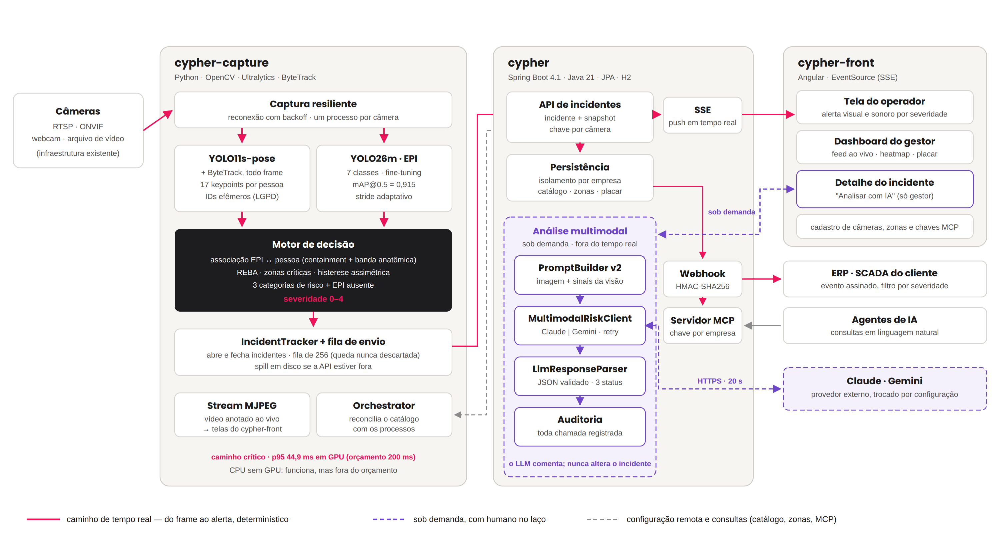

# Arquitetura — Cypher (3 repositórios)

**Domínio:** monitoramento de segurança industrial (uso de EPI, postura de risco, quedas) por visão computacional, para a Metaindústria (Challenge SPI/FIAP).

Este documento liga os três repositórios que compõem o sistema e explica como subi-los juntos localmente. Complementa (não substitui) os runbooks já existentes:
- `docs/e1-runbook-local.md` — passo a passo de subir os três projetos com vídeo real.
- `docs/empresa-demo-runbook.md` — dados de demonstração (empresa `demo`, câmeras reais da meta indústria, equipes de teste).
- `docs/superpowers/specs/2026-08-29-roteiro-de-entregas.md` — histórico completo de decisões de arquitetura e ordem de entregas.

---

## 1. Os três repositórios

| Repositório | Papel | Stack | Onde roda |
|---|---|---|---|
| [`cypher-capture`](https://github.com/lucvs07/cypher-capture) | Visão computacional em tempo real — decide quando um incidente começa e termina | Python, YOLO26m (EPI) + YOLO11s-pose/ByteTrack (postura e queda) | um processo por câmera, na borda (junto da câmera/estação) ou num host de captura |
| [`cypher`](https://github.com/lucvs07/Cypher-Api) (backend) | Recebe, persiste e expõe incidentes; autenticação, papéis, multi-tenant, relatórios, análise por LLM | Spring Boot 4.1 / Java 21, H2 embarcado | um processo central, um por instância (mono-tenant por instância de orquestrador, multi-tenant por `Empresa` dentro do backend) |
| [`cypher-front`](https://github.com/Ronaldovels/cypher-front) | Dashboard, heatmap, timeline de incidentes, cadastro, placar de gamificação, central de notificações | Angular 21 (standalone + signals) | SPA servida separadamente (`ng serve`/build estático) |

## 2. Diagrama de integração

Visão final do sistema (as três camadas, os canais de saída e os dois papéis de usuário):



Detalhe das autenticações e das rotas entre os repositórios:

```
┌──────────────────┐        HTTPS (REST, autenticado)        ┌──────────────────┐
│  cypher-capture   │ ───────────────────────────────────────▶│      cypher       │
│  (por câmera)      │  X-Cypher-Key (chave de API da câmera) │   (Spring Boot)    │
│                    │◀─────────────────────────────────────── │                    │
│  orchestrator/     │   GET /cameras/{id}/config              │  Usuario/Equipe/   │
│  (sobe/derruba      │   GET /cameras/{id}/zones/config        │  Empresa/Camera/   │
│  processos, 1 por   │   POST /incidents (novo incidente)      │  Estacao/Zona/     │
│  câmera)            │   POST /cameras/{id}/heartbeat (E5)     │  Alerta/Webhook    │
└──────────────────┘                                          └─────────┬─────────┘
                                                                          │
                                              HTTPS (REST + SSE)         │
                                              cookie HttpOnly            │
                                              (sessão GESTOR/OPERADOR)   │
                                                                          ▼
                                                                ┌──────────────────┐
                                                                │   cypher-front     │
                                                                │   (Angular SPA)    │
                                                                │  Dashboard/Heatmap/ │
                                                                │  Incidentes/Placar/ │
                                                                │  Config/Notificações│
                                                                └──────────────────┘
```

Três mecanismos de autenticação coexistem na mesma cadeia de filtros do backend, sem JWT nem servidor de autenticação separado:
1. **Chave de API por câmera** (`X-Cypher-Key`) — `cypher-capture` → `cypher`, sem sessão, uma chave por câmera, rotacionável.
2. **Sessão de gestor** (cookie `HttpOnly`) — `cypher-front` → `cypher`, acesso completo ao tenant (`Empresa`) do gestor.
3. **Sessão de operador** (cookie `HttpOnly`, via usuário/senha ou token de estação no kiosk) — `cypher-front` → `cypher`, restrita à própria `Estacao`.

Cookie (não JWT) por decisão de design: o `EventSource` do SSE (atualização em tempo real do dashboard/timeline/notificações) não aceita header customizado, então cookie é a única opção que cobre autenticação HTTP e stream ao mesmo tempo.

## 3. Multi-tenant

O backend isola dados por `Empresa` (chave primária prefixada `empresaId:codigo` nas entidades `Estacao`/`Camera`/`Equipe`/`Zona`/`Alerta`/`WebhookSubscription`). O orquestrador de pipelines (`cypher-capture`) é **mono-tenant por instância** — rodar câmeras de duas empresas no mesmo host exige dois processos de orquestrador, cada um com sua própria conta de serviço `GESTOR`. Decisão de design registrada, não uma limitação a resolver depois.

## 4. Subindo os três projetos localmente

Pré-requisitos: Java 21, Node 20+, Python 3.11+ com `venv`. Webcam, GPU e chave de LLM são opcionais: sem GPU o capture roda em CPU (poucos FPS), sem webcam ele lê o vídeo de demonstração versionado em `cypher-capture/data/demo/`, e sem chave de LLM só a análise por IA fica indisponível.

**Caminho rápido:** `scripts/subir-empresa-demo.sh start` (mesmo script, copiado nos 3 repositórios — roda a partir de qualquer um deles) sobe os três processos em sequência, semeia a empresa `demo` na primeira vez e inicia um pipeline sobre o vídeo de demonstração (`--source 0` para a webcam). Ele encontra os repositórios nas pastas vizinhas, então clone os três lado a lado. `./scripts/subir-empresa-demo.sh stop`/`status`/`logs` gerenciam os processos depois. Ver o cabeçalho do script para variáveis de ambiente (caminhos dos repositórios, senha do gestor, `--orchestrator` para reconciliar o catálogo completo em vez de só a webcam).

**Passo a passo manual** (o que o script acima automatiza):

```bash
# 1. Backend
cd cypher            # backend (pasta vizinha)
./mvnw spring-boot:run
# pronto quando logar "Started ... in Xs" — confira com:
curl -s localhost:8080/api/v1/cameras

# 2. Front
cd cypher-front
npm install   # primeira vez
npm start     # serve em http://localhost:4200

# 3. Capture (um processo por câmera; troque cpu por cuda se tiver GPU)
cd cypher-capture
./venv/bin/python src/run_pipeline.py \
  --source data/demo/validacao-camera-2026-10-14.mp4 \
  --device cpu --no-display \
  --camera-id CAM-01 \
  --api-url http://localhost:8080/api/v1 \
  --stream-port 8090
```

Para dados de demonstração prontos (câmeras reais da meta indústria, equipes de teste, gestor/operadores seedados), rode `scripts/seed-empresa-demo.sh` do repo `cypher` — ver `docs/empresa-demo-runbook.md` para o passo a passo completo e a pegadinha de qual câmera o dashboard renderiza por padrão (`cameras()[0]`).

Para produção/orquestração contínua (sem subir cada câmera manualmente), o `cypher-capture` inclui `src/orchestrator/` (`python -m src.orchestrator`) — reconcilia o catálogo de câmeras do backend com os processos rodando, sobe/derruba/reinicia automaticamente.

## 5. Convenções compartilhadas entre repositórios

- **Design consistente no front**: toda tela nova reaproveita os primitivos globais de `src/styles.scss` (ver [`design-system.md`](design-system.md)) — nenhuma biblioteca de UI externa, nenhum CSS solto por componente além de layout local.
- **TDD tarefa-a-tarefa**: toda entrega nos três repositórios segue spec (`docs/superpowers/specs/`) → plano de implementação com tarefas testadas uma a uma (`docs/superpowers/plans/`) → revisão de branch inteira antes do PR.
- **Testes automatizados por repositório, sem mocks entre serviços na integração real**: os specs automatizados usam `HttpTestingController`/mock interceptor (front) e `HttpServer` local embutido (backend, para chamadas ao `cypher-capture`/LLM), mas toda entrega recebe também um teste manual ponta a ponta com os três processos rodando de verdade antes do merge.
- **Segredos nunca versionados**: `data/cypherdb.mv.db` (backend) e `outputs/apikey-cache.json`/`.env` (capture) são gitignorados de propósito — carregam tokens de estação, api-keys de câmera e credenciais RTSP em texto puro.

## 6. Stack e justificativas

| Camada | Escolha | Por que |
|---|---|---|
| Front | Angular 21 (standalone + signals), sem biblioteca de UI | Signals simplificam o estado em tempo real vindo do SSE; os primitivos próprios em `src/styles.scss` mantêm o visual consistente sem dependência externa ([`design-system.md`](design-system.md)) |
| Backend | Spring Boot 4.1, Java 21 | Segurança (`Spring Security`), JPA e validação prontos; o mesmo processo serve REST, SSE e MCP |
| Banco | H2 embarcado em modo arquivo | Instalação sem banco externo, requisito para o avaliador subir o sistema só com o README. Limite assumido: não é um banco de produção |
| Tempo real | SSE (`EventSource`) | O fluxo é só servidor → navegador; WebSocket seria complexidade sem ganho. O alerta chega ao operador em menos de 5 s |
| Autenticação | Cookie `HttpOnly` de sessão, sem JWT | `EventSource` não aceita header customizado, e um único cookie cobre REST e SSE. A câmera usa chave de API própria (`X-Cypher-Key`) |
| Detecção de EPI | YOLO26m (`exp-m4-1709-v4`) | mAP@0.5 de 0,915 com 13% menos compute que o detector anterior; escolhido pelo comportamento em cena e não só pelo mAP. Números e fontes: [`metricas-finais.md`](https://github.com/lucvs07/cypher-capture/blob/main/docs/metricas-finais.md) |
| Pose e postura | YOLO11s-pose + ByteTrack + REBA | 17 keypoints COCO alimentam o REBA; o ByteTrack mantém a identidade por pessoa para a histerese |
| Decisão de incidente | Histerese assimétrica (entra rápido, sai devagar) | Evita alarme que pisca; o recall de risco imediato é prioridade explícita |
| Análise de risco | LLM multimodal (Claude ou Gemini), opcional | Segundo estágio sobre o quadro do incidente; só roda por ação do gestor. Sem chave, o resto do sistema funciona |
| Integração externa | Webhooks com assinatura e servidor MCP | Canais de saída além do painel: sistemas legados e agentes de IA |
| Captura | Um processo por câmera, reconciliado por orquestrador | Isola falhas por câmera; o orquestrador sobe, derruba e reinicia conforme o catálogo |

## 7. Decisões técnicas por Sprint

| Sprint | Decisão | Motivo |
|---|---|---|
| 1 e 2 | Protótipo de alta fidelidade no Figma (onboarding, dashboard, heatmap) | Validar a interface antes de implementar |
| 3 | Do protótipo para a implementação: telas novas nascem como componente Angular, não como artboard | O tempo foi para o produto rodando; ver [`fluxo-de-telas.md`](fluxo-de-telas.md) |
| 3 | Cookie em vez de JWT | SSE (ver seção 2) |
| 3 | Multi-tenant por `Empresa`, chave composta `empresaId:codigo` | Isolamento sem FK entre entidades; aceita câmera ainda não cadastrada |
| 3 | Orquestrador de pipelines, mono-tenant por instância | Gap real achado no teste de multi-tenant; um processo por câmera |
| 3 | Chave de API por câmera | Ingestão autenticada sem sessão |
| 3 | Zonas de risco editáveis pela interface, com hot-reload | Sem reiniciar o pipeline para mudar uma zona |
| 3 | Gating temporal de queda | Reduzir falso positivo de queda |
| 3 | Análise por LLM multimodal sobre o snapshot | Segundo estágio humano-no-circuito; opcional |
| 4 | Servidor MCP no backend e credenciais pela tela `/config/mcp` | Agentes de IA consultarem incidentes, catálogo e dashboard |
| 4 | REBA com câmera angulada (rotação e roll da câmera) | Câmeras da fábrica não ficam de frente; PRs #12 (capture) e #14 (backend) |
| 4 | Checklist global de EPI e só os 6 EPIs que o modelo detecta | Contrato do front e da API igual ao que o modelo entrega |
| 4 | Fixes de tracker, sink e webhook | Memória do tracker, rejeição 4xx sem reenvio, timeout de webhook, `closedReason` renotificado |
| 4 | Vídeo de demonstração versionado e script que acha os repositórios vizinhos | Instalação limpa sem webcam, GPU ou chave de LLM |

Cada decisão tem o desenho em `docs/superpowers/specs/` e o histórico em `docs/superpowers/specs/2026-08-29-roteiro-de-entregas.md`.

## 8. O que não faz parte do sistema

O repositório `cypher-cs` (app mobile em Expo/React Native com lista de registros, cadastro e detalhe) foi um entregável da Sprint 2. **Ele não faz parte da solução final**: não consome o backend, não aparece no diagrama e não é necessário para rodar nada do Cypher.

## 9. Gaps arquiteturais conhecidos

- Painel de super-admin multi-empresa (gestão entre empresas, cobrança): não foi pedido, registrado em `2026-08-29-multi-tenant-design.md` §9.
- Rotação automática de token de estação e limite de tentativas de login: fora de escopo desde a E4.
- Zona ainda não recorta o frame: `ZoneDetector` alimenta um indicador, não restringe o processamento de pose e de EPI.
- H2 embarcado: bom para demonstração e instalação, mas uma implantação real na Metaindústria deve trocar por um banco servidor.
- Desempenho em CPU abaixo do orçamento de 200 ms por quadro: o orçamento só se cumpre em GPU ([`metricas-finais.md`](https://github.com/lucvs07/cypher-capture/blob/main/docs/metricas-finais.md)).
- Acurácia de ergonomia em câmera de perfil abaixo da meta, e deploy com 3 ou mais câmeras reais na Metaindústria ainda não realizado.

Fechados desde a Sprint 3: correção de perspectiva do REBA para câmera angulada (PR #12 do capture) e rotação de câmera personalizável (PR #14 do backend).
