# Manual de uso do Cypher

Para quem usa o sistema no dia a dia: o **gestor de SSMA** (segurança, saúde e meio ambiente) e o **operador** de uma estação de trabalho. Para instalar e subir o sistema, veja o [README](../README.md). Os prints foram tirados da empresa `demo`, com dados simulados.

## Como o Cypher funciona, em três linhas

Uma câmera aponta para a estação. O Cypher observa EPI e postura e, quando confirma que algo está errado, **abre um incidente**. O operador recebe o aviso na hora e o gestor acompanha tudo no painel.

Cada incidente tem uma **severidade**: Médio (por exemplo, postura inadequada) ou Alto (por exemplo, queda ou risco imediato). Ele passa por três **status**: Pendente, Revisado e Resolvido.

---

## 1. Primeiro acesso e login

### Primeiro acesso (onboarding)

Na primeira vez, a página inicial (`/`) leva ao **onboarding**: o gestor cria a conta do gestor mestre e configura a empresa (nome, cores, EPIs exigidos). Depois disso, o acesso é pelo login.

Na empresa `demo` o gestor já existe, então vá direto ao login. Enquanto o onboarding da empresa não for concluído, o painel mostra o aviso "Configuração pendente" no topo.

### Login do gestor

`/login`: informe usuário e senha. Na empresa `demo`: `gestor@demo` / `demo12345`.

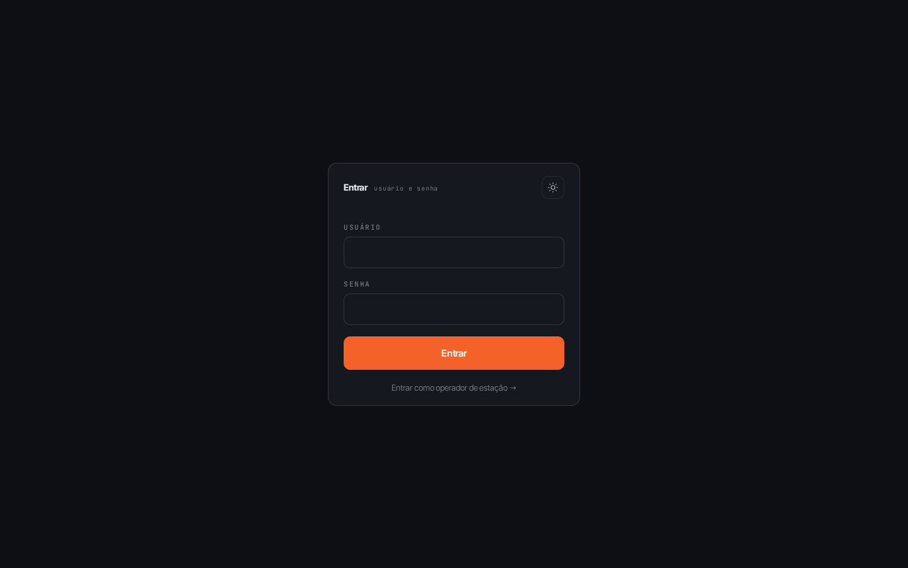

### Login do operador (kiosk)

O operador entra de duas formas:

- **Usuário e senha** em `/login`, com a conta da estação (por exemplo `operador.esteira@demo` / `operador123`). Ele cai direto na tela da própria estação.
- **Token da estação** em `/login-estacao`, pensado para um dispositivo fixo na estação, sem digitar usuário e senha. O gestor gera e renova o token na configuração de estações.

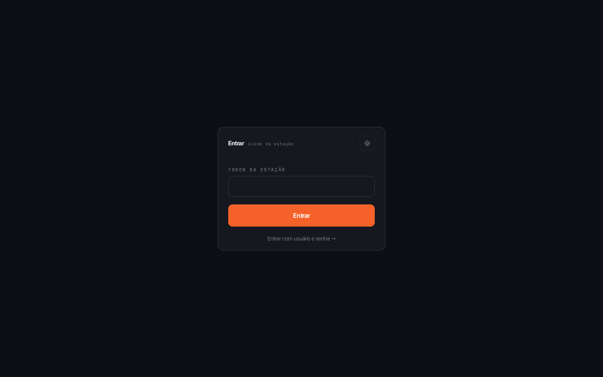

O operador só enxerga a própria estação. Ele não acessa o painel do gestor nem as configurações, mesmo digitando o endereço na barra do navegador.

---

## 2. Gestor

A navegação fica numa barra flutuante na parte de baixo (**Dashboard, Ao Vivo, Alertas, Heatmap, Placar, Colaboradores, Configurações**). No topo ficam o sino de notificações, o botão de tema claro e escuro, as configurações e a saída.

### 2.1 Dashboard

A visão geral em tempo real: incidentes de hoje, críticos de hoje, pendentes de revisão e câmeras monitoradas; o mapa de calor resumido por estação; os alertas recentes; e a câmera ao vivo. Novos incidentes aparecem sem recarregar a página.

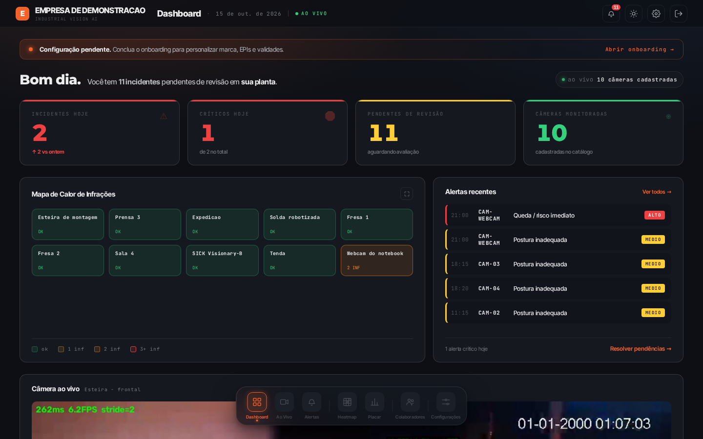

Use **Ver todos** ou **Resolver pendências** para ir à lista de incidentes.

### 2.2 Heatmap

Mostra onde e quando as infrações se concentram. Filtre por **Período**, **Setor**, **EPI** e **Turno**. Os painéis Temporal e Anual mostram a distribuição ao longo do dia e do ano. **Exportar PDF** gera o resumo do que está na tela.

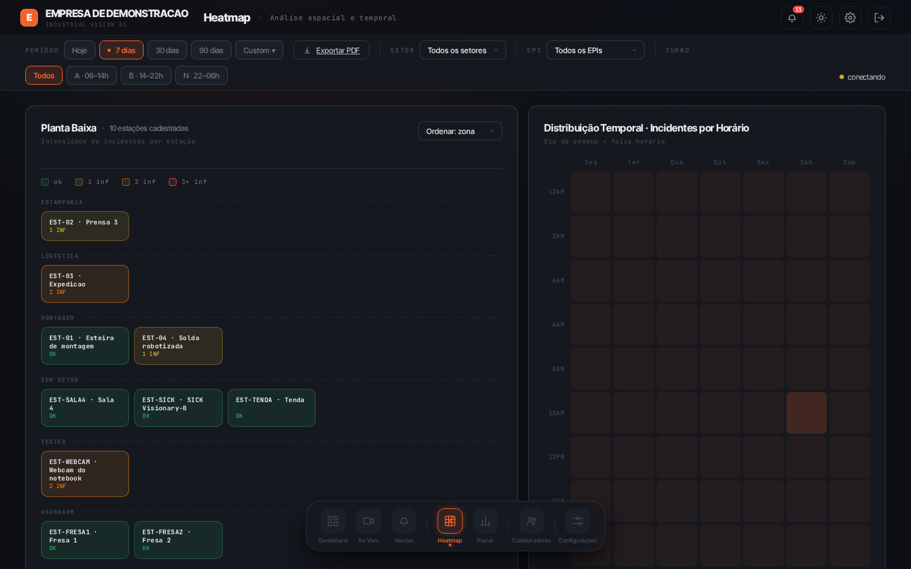

### 2.3 Incidentes

A lista de todos os incidentes, do mais recente ao mais antigo. Filtre por câmera, severidade mínima, status e data inicial, e use **exportar CSV** para levar a lista para uma planilha. Clique em um incidente para ver o detalhe.

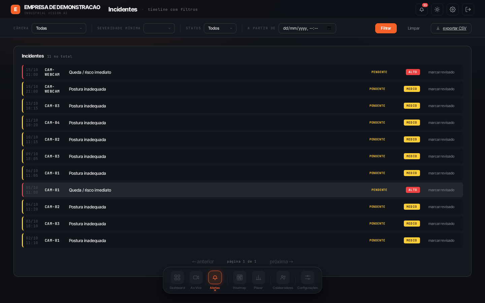

### 2.4 Detalhe do incidente e análise por IA

O detalhe mostra o quadro da câmera no momento do incidente, a severidade, o score REBA (a nota de risco ergonômico), a zona, os EPIs presentes e os ausentes.

- **Mudar o status:** use **Pendente**, **Revisado** ou **Resolvido** no rodapé. Resolva depois de tomar a providência.
- **Analisar com IA:** pede a um modelo multimodal uma leitura da cena e uma ação recomendada. É uma segunda opinião e não substitui a decisão do gestor. Só funciona se o administrador do sistema configurou uma chave de LLM; sem ela, o botão não traz resultado e o resto do sistema não é afetado.

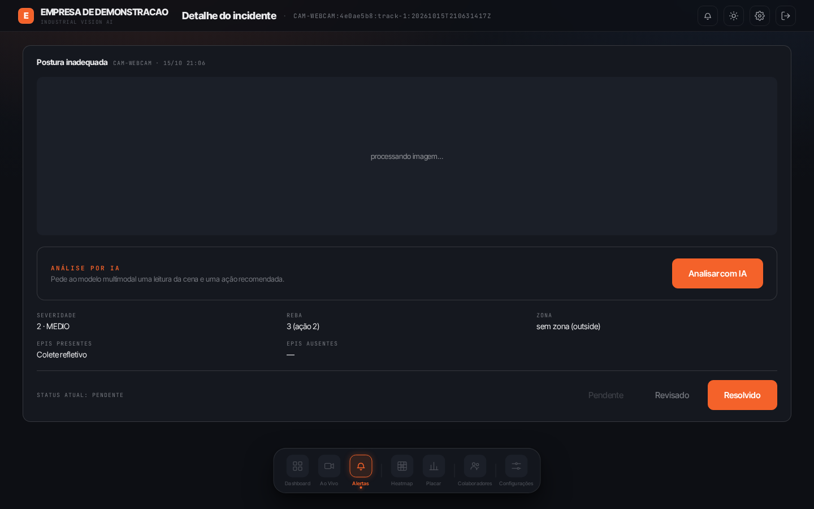

### 2.5 Ao Vivo

A grade de câmeras, agrupada por setor (**Por setor**) ou numa grade única (**Grade única**). Use para olhar uma estação sem esperar um incidente. Clique numa estação para abrir o kiosk dela.

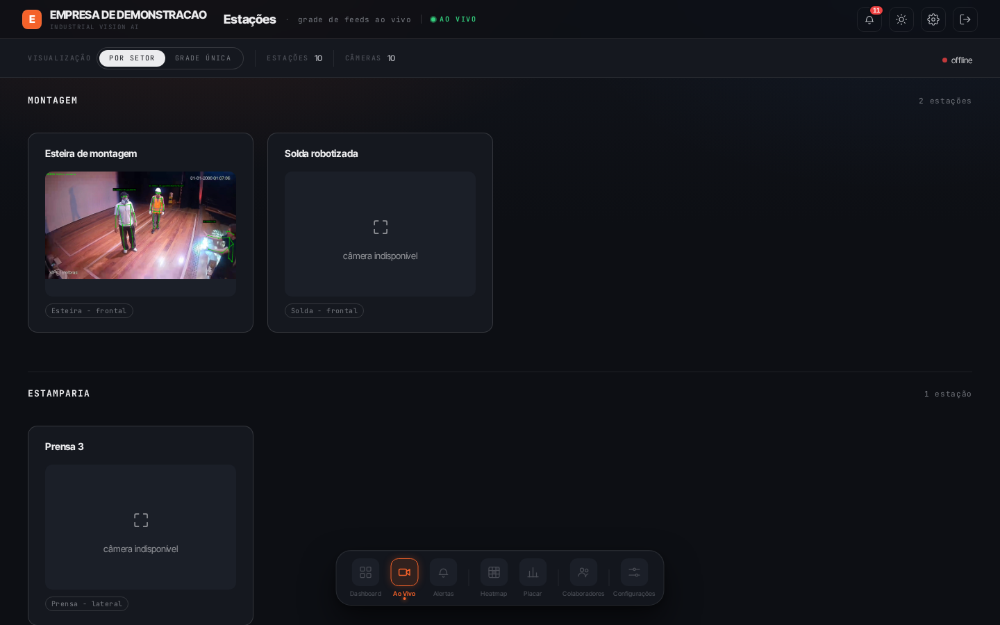

### 2.6 Placar

A gamificação por equipe: conformidade, cobertura, sequência de dias sem incidente e ranking. Equipes que melhoram aparecem destacadas, e equipes com poucos dados são marcadas como "dados insuficientes". **Exportar CSV** leva o placar para uma planilha.

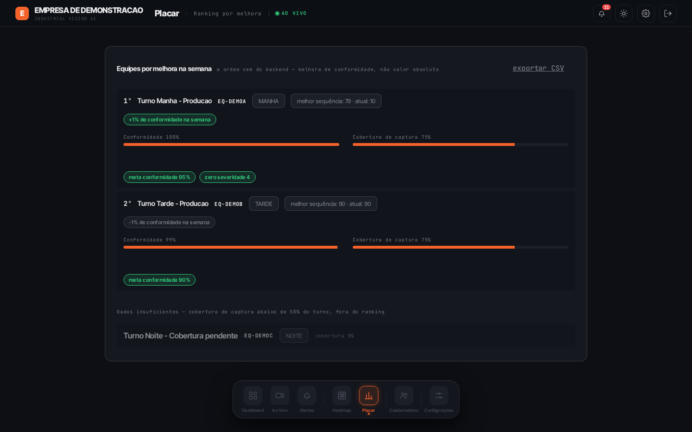

### 2.6.1 Central de notificações

O sino no topo mostra o número de alertas não lidos. Ao abri-lo, você vê a lista de alertas recentes, do mais novo ao mais antigo. Os alertas lidos saem da contagem, que é por usuário.

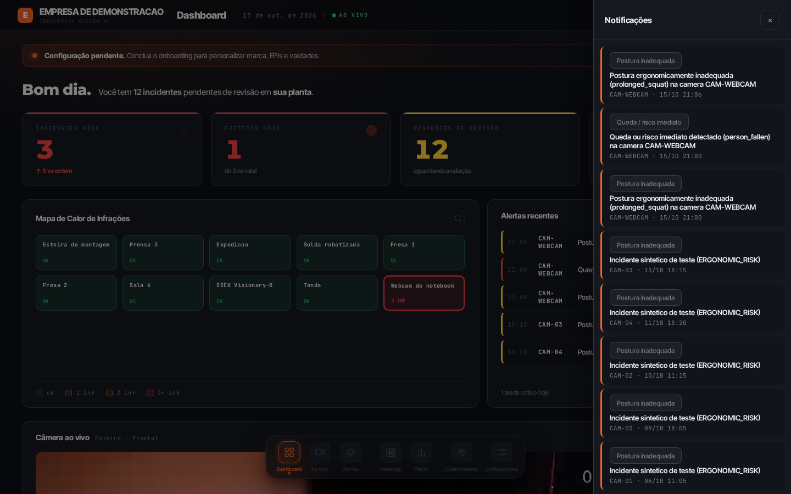

### 2.7 Configurações

O ícone de engrenagem abre as configurações, em abas.

**Estações e câmeras** (`/config/estacoes`). Cadastre estações (código, nome e setor) e as câmeras de cada uma (código, estação, URL do stream e fonte de captura). Para câmeras que não ficam de frente para a cena, ajuste a **rotação** e o **ângulo de inclinação**. Ali também ficam os limiares de detecção de queda e o **editor de zonas de risco**: clique em **editar zonas** na câmera, capture um quadro e desenhe o polígono da área restrita sobre ele. A zona vale para o pipeline em até cerca de 30 segundos, sem reiniciar nada.

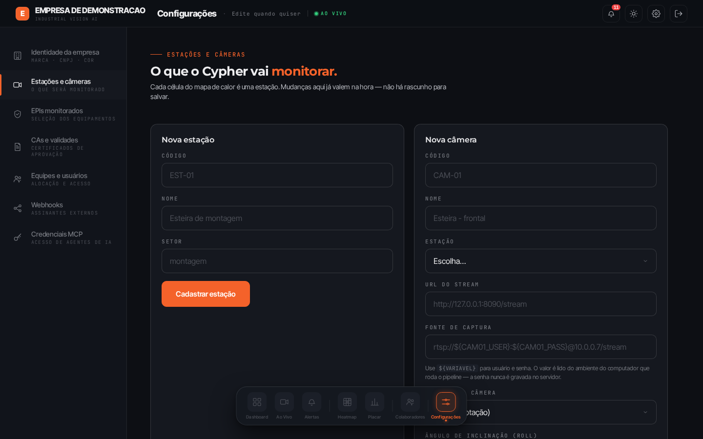

**Identidade** (`/config/identidade`). Nome da empresa, CNPJ, setor industrial, logo (SVG ou PNG), cor principal e tema claro ou escuro. O tema muda na hora; os demais campos pedem **Salvar**.

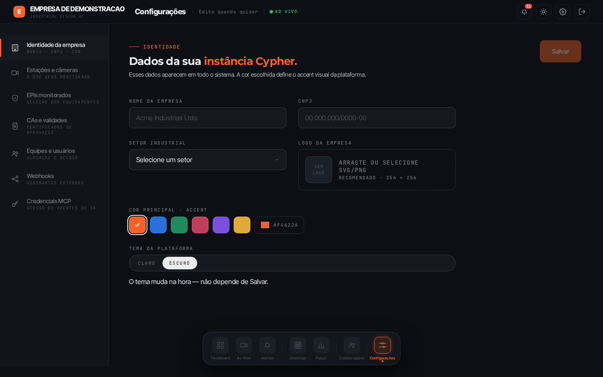

**EPIs** (`/config/epis`). Escolha quais EPIs a operação exige. O Cypher monitora capacete, óculos, luva, colete, bota e máscara. Esse checklist vale para a empresa toda.

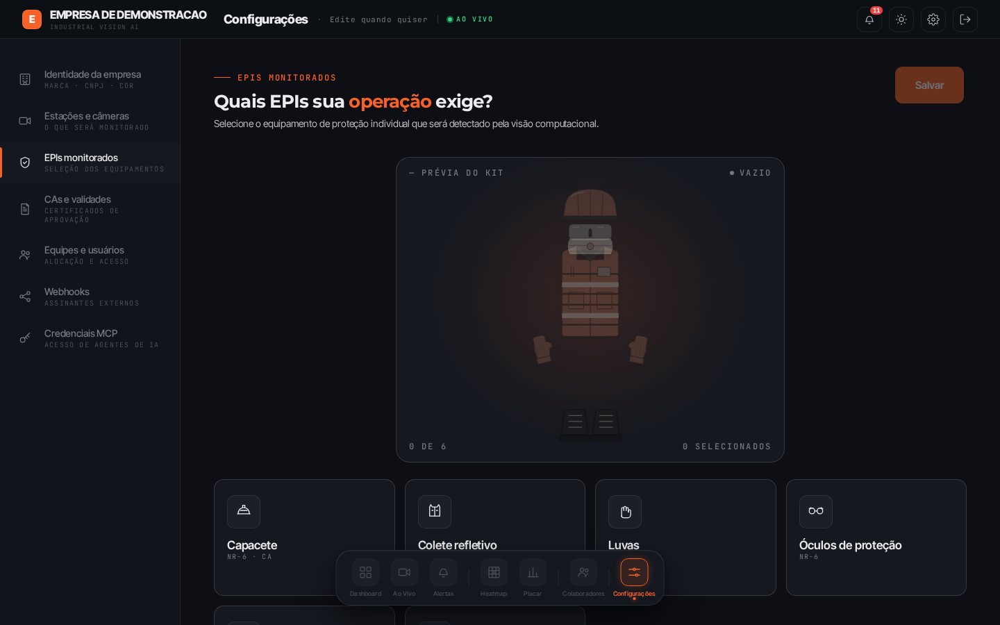

**CAs** (`/config/cas`). Certificados de aprovação dos EPIs.

**Equipe** (`/config/equipe`). Duas abas. Em **Equipes**, cadastre código, nome, turno, as estações que a equipe cobre e, se quiser, metas de conformidade e de tempo de reconhecimento. Em **Usuários**, cadastre usuário, papel (gestor ou operador), senha e, para operador, a estação.

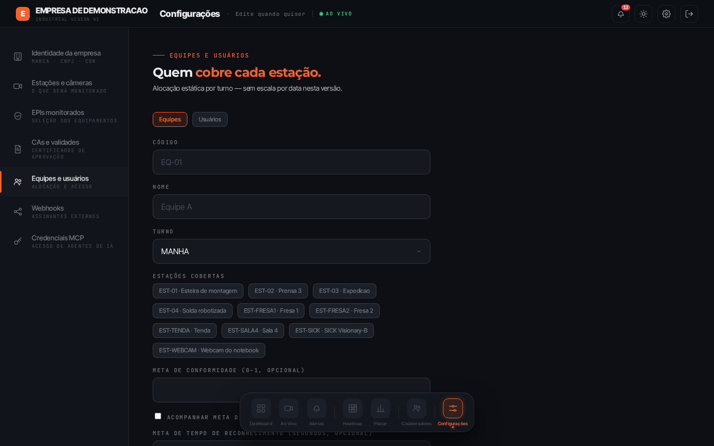

**Webhooks** (`/config/webhooks`). Cadastre os sistemas externos que devem receber cada incidente, com um segredo para validar a origem e a severidade mínima a partir da qual notificar. Na aba **Histórico**, escolha um assinante para ver se cada entrega chegou.

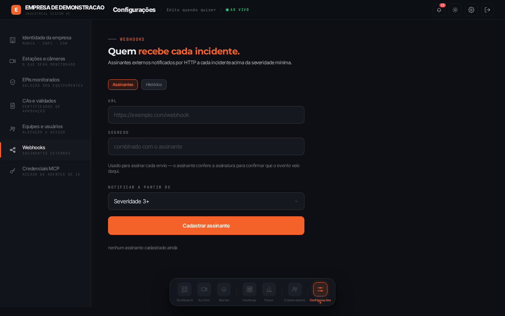

**MCP** (`/config/mcp`). Gere uma credencial para um agente de IA (como o Claude) consultar os incidentes e o catálogo do Cypher. Dê um nome à credencial e clique em **Gerar credencial**. A chave aparece **uma única vez**; copie antes de fechar. Se perdê-la, use **revogar** e gere outra. O passo a passo de uso está em [`mcp-runbook.md`](mcp-runbook.md).

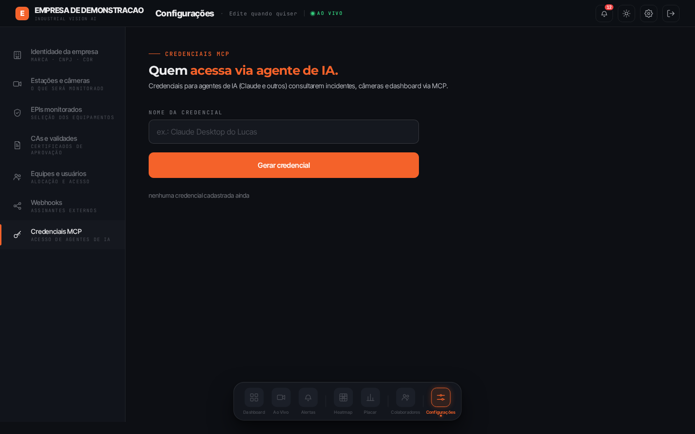

---

## 3. Operador (kiosk da estação)

Depois do login, o operador vê a tela da própria estação (`/estacao/<código>`):

- a **câmera ao vivo** da estação, com o esqueleto e a zona desenhados sobre a imagem;
- o **checklist de EPIs** exigidos na empresa;
- os **eventos recentes** da estação.

Quando um incidente da estação é confirmado, o kiosk **toca um bipe e destaca o aviso na tela**. O aviso visual existe porque o som sozinho falha se o dispositivo estiver mudo. O operador pode reconhecer o incidente (**Revisado**) ou marcá-lo como **Resolvido** na tela de detalhe.

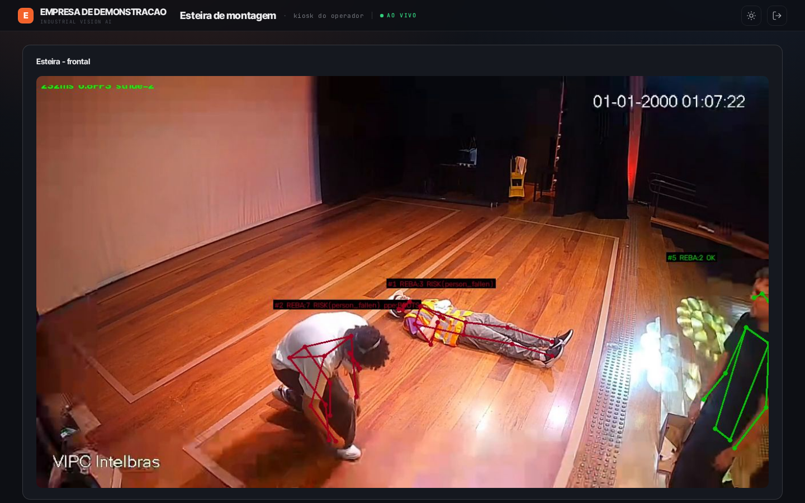

O som só toca para incidentes das câmeras da própria estação. Se a página nunca recebeu um clique, alguns navegadores bloqueiam o som: clique uma vez na tela ao abri-la.

---

## 4. Dúvidas comuns

**Não aparece nenhum incidente novo.** Confira se o pipeline de captura está no ar (`./scripts/subir-empresa-demo.sh status`). Sem câmera, o sistema continua mostrando o histórico.

**A detecção está lenta.** Sem GPU o pipeline roda em poucos quadros por segundo. É esperado e não muda o que é detectado.

**O botão "Analisar com IA" não responde.** A análise precisa de uma chave de LLM no backend. Peça ao administrador.

**Perdi a chave do MCP.** Revogue a credencial e gere outra. A chave não é guardada em texto no sistema.

**Para onde vão as imagens?** Elas ficam no sistema da empresa. O envio de um quadro a um provedor de LLM só acontece quando o gestor clica em **Analisar com IA**.
